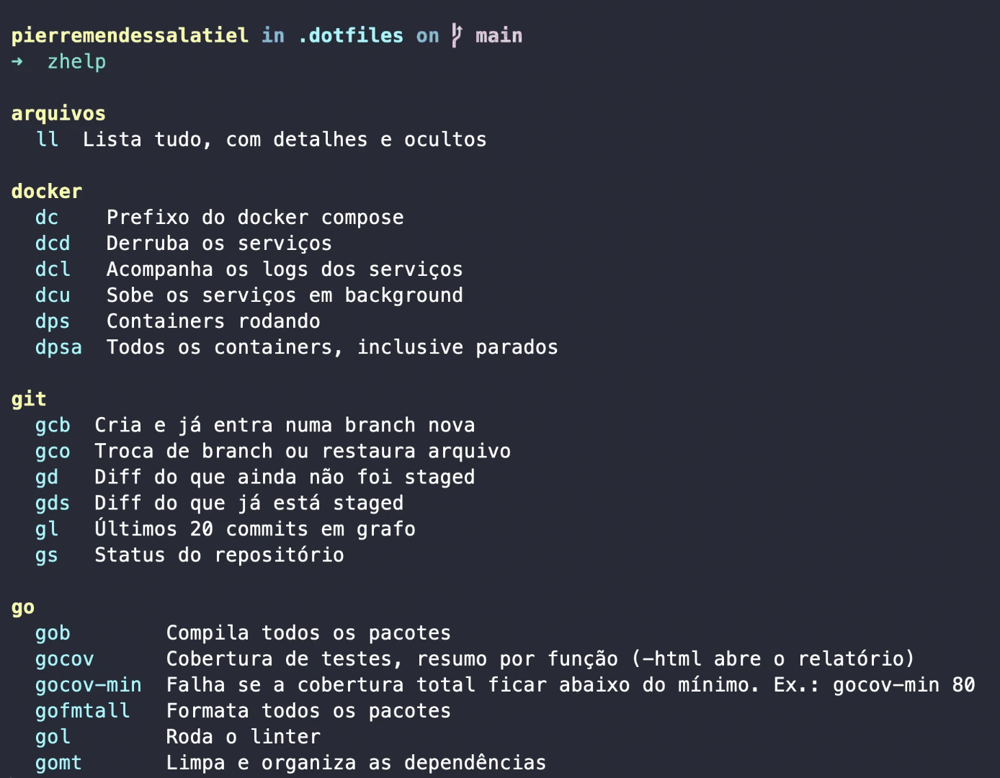

# dotfiles

Minha configuração de Zsh — Oh My Zsh + tema Spaceship, autosuggestions, syntax highlighting, busca no histórico pelas setas, fzf, zoxide, e atalhos para Git, Docker, PHP/Laravel, Node e Go.

O mesmo `zshrc` roda em **macOS**, **Linux** e **Windows (via WSL2)**. As diferenças entre sistemas são detectadas em tempo de execução, não existem dois arquivos para manter.

Inclui uma ferramenta de atalhos que se documentam sozinhos: `zhelp` lista o que existe, `znew` cria.



> O `zhelp` listando os atalhos por grupo, com o prompt Spaceship, o tema Dracula e a fonte MesloLGS Nerd Font. O passo a passo das cores está em [Aparência: tema Dracula](#aparência-tema-dracula).

---

## Instalação

O `install.sh` é o mesmo nos três sistemas e é idempotente — pode rodar de novo a qualquer momento para atualizar plugins e tema. Ele instala as dependências, instala o Oh My Zsh se não houver, clona os plugins e o tema, faz backup do seu `~/.zshrc` atual em `~/.dotfiles-backup/<timestamp>/`, cria o symlink e gera o `~/.zshrc.local` com `chmod 600`.

### macOS

Nada a preparar além do Command Line Tools (o script instala o Homebrew se faltar).

```bash
xcode-select --install          # se ainda não tiver
git clone https://github.com/Pierre-Mendes/dotfiles.git ~/.dotfiles
cd ~/.dotfiles
./install.sh
```

Torne o zsh o shell padrão (no macOS moderno ele já é):

```bash
chsh -s /bin/zsh
```

Se instalou o zsh pelo Homebrew e quer usar esse em vez do do sistema:

```bash
echo "$(brew --prefix)/bin/zsh" | sudo tee -a /etc/shells
chsh -s "$(brew --prefix)/bin/zsh"
```

Fonte com os ícones do prompt:

```bash
brew install --cask font-meslo-lg-nerd-font
```

Depois selecione **MesloLGS NF** no terminal — iTerm2: *Settings → Profiles → Text → Font*. Terminal.app: *Settings → Profiles → Text → Change Font*.

Feche e abra o terminal, ou rode `exec zsh`.

---

### Linux (Debian / Ubuntu)

```bash
sudo apt update && sudo apt install -y git curl
git clone https://github.com/Pierre-Mendes/dotfiles.git ~/.dotfiles
cd ~/.dotfiles
./install.sh
```

Torne o zsh o shell padrão:

```bash
chsh -s "$(which zsh)"
```

Fonte com os ícones — baixe uma Nerd Font e instale no usuário:

```bash
mkdir -p ~/.local/share/fonts
cd ~/.local/share/fonts
curl -fLO https://github.com/ryanoasis/nerd-fonts/releases/latest/download/Meslo.zip
unzip -o Meslo.zip && rm Meslo.zip
fc-cache -f
```

Depois selecione **MesloLGS NF** nas preferências do seu terminal.

Faça logout e login (a troca de shell só vale na próxima sessão), ou rode `exec zsh`.

> Em distros que não usam `apt`, o script avisa e lista o que instalar na mão: `zsh git curl fzf bat zoxide go`.

---

### Windows (WSL2)

Zsh não roda nativamente no Windows — nem no PowerShell, nem no CMD. O caminho é o **WSL2**, que dá um Linux real; dali para a frente tudo é idêntico ao Linux.

**1. Instalar o WSL2.** Abra o PowerShell **como administrador**:

```powershell
wsl --install -d Ubuntu
```

Reinicie o computador. Na primeira abertura do Ubuntu ele pede um nome de usuário e senha — esses são do Linux, não têm relação com a conta do Windows.

Se o WSL já estava instalado, confirme que está na versão 2:

```powershell
wsl --set-default-version 2
wsl -l -v
```

**2. Instalar a config.** Dentro do terminal do Ubuntu:

```bash
sudo apt update && sudo apt install -y git curl
git clone https://github.com/Pierre-Mendes/dotfiles.git ~/.dotfiles
cd ~/.dotfiles
./install.sh
chsh -s "$(which zsh)"
```

Saia e entre de novo no WSL (`exit` e reabrir) para a troca de shell valer.

**3. Fonte.** A fonte é instalada no **Windows**, não no Ubuntu. Baixe o [Meslo Nerd Font](https://github.com/ryanoasis/nerd-fonts/releases/latest/download/Meslo.zip), extraia, selecione os `.ttf`, clique com o botão direito e escolha *Instalar*.

No **Windows Terminal**: *Configurações → Perfis → Ubuntu → Aparência → Tipo de fonte → MesloLGS NF*.

**Detalhes que evitam dor de cabeça no WSL:**

- Mantenha os projetos dentro do sistema de arquivos do Linux (`~/code`), **não** em `/mnt/c/...`. O acesso cruzado é muito mais lento e quebra o `git status` do prompt em repositórios grandes.
- Para o Docker funcionar, instale o **Docker Desktop** no Windows e ative *Settings → Resources → WSL Integration* para a distro Ubuntu. A seção de compose do prompt usa o `docker` do WSL.
- Abra o WSL pelo **Windows Terminal**, não pela janela legada do console — a antiga não renderiza os ícones direito.

---

## Depois de instalar, nos três sistemas

Dois arquivos guardam o que é seu e ficam fora do versionamento:

| Arquivo | Para quê |
|---|---|
| `~/.zshrc.local` | tokens, variáveis de ambiente, funções e hosts específicos seus |
| `~/.zsh_aliases.local` | seus atalhos — gerenciado pelo `znew`, não precisa editar à mão |

O primeiro é criado a partir do `zshrc.local.example` com `chmod 600`:

```bash
$EDITOR ~/.zshrc.local
```

---

## Aparência: tema Dracula

As cores do print lá em cima são o [Dracula](https://draculatheme.com/). Ele é configuração do **app de terminal**, não do zsh — por isso não entra no `install.sh` nem neste repositório. São três passos, e a ordem importa.

### 1. Importar o tema

No macOS, com o Terminal.app:

```bash
curl -fsSL -o ~/Downloads/Dracula.terminal https://raw.githubusercontent.com/dracula/terminal-app/master/Dracula.terminal
open ~/Downloads/Dracula.terminal
```

O segundo comando importa o perfil e já abre uma janela com ele. Em seguida, **Terminal → Settings → Profiles**, selecione **Dracula** e clique em **Default** no rodapé da lista — sem isso, cada janela nova volta ao perfil anterior.

Para iTerm2, Windows Terminal, GNOME Terminal, VS Code e outros, os arquivos estão em [draculatheme.com](https://draculatheme.com/).

### 2. Corrigir a fonte

**Este passo é obrigatório e vem depois do primeiro.** O perfil do Dracula embute a **SF Mono**, que não tem os ícones do prompt — ao importar, ele sobrescreve a Nerd Font que o `install.sh` instalou, e o Spaceship passa a mostrar quadradinhos.

Volte em **Profiles → Dracula → aba Text → Change…** e escolha **MesloLGS Nerd Font Mono**, tamanho 15 ou 16. No Terminal.app prefira a variante **Mono**, que respeita a largura fixa de caractere.

Se a fonte não aparecer na lista, desmarque **Fixed width fonts only** no painel de fontes.

### 3. Tamanho da janela

O perfil do Dracula não define tamanho. Em **Profiles → Dracula → aba Window → Window Size**, 120 colunas × 35 linhas é um bom ponto de partida; num monitor externo, 160 × 45.

Abra uma janela nova (`⌘N`) para ver o resultado — as já abertas mantêm o perfil antigo.

### E o `bat`

Nada a fazer: o `cat` deste repositório usa o `bat`, e o `zshrc` já define `BAT_THEME="Dracula"`, então o highlight combina com o terminal. Para outro tema, defina `BAT_THEME` no `~/.zshrc.local` — `bat --list-themes` mostra as opções.

---

## Atalhos: zhelp e znew

O problema de ter muitos aliases é esquecer que eles existem. Aqui cada atalho é declarado junto com uma descrição, e o `zhelp` monta a lista a partir disso — não há documentação para manter em paralelo.

### Consultar

```bash
zhelp              # tudo, agrupado por categoria
zhelp git          # só o grupo git
zhelp gs           # detalhe: o que expande, de onde veio
zhelp -s docker    # busca em nome, descrição e comando
zhelp -h           # os comandos da ferramenta
```

O detalhe de um atalho mostra para onde ele expande e em qual arquivo foi definido — útil quando você não lembra se criou algo no repo ou só naquela máquina.

### Criar

Com o assistente:

```bash
znew
```

Ele pergunta nome, comando, grupo e descrição. Ou tudo de uma vez:

```bash
znew gp 'git push origin HEAD' -g git -d 'Envia a branch atual'
```

O atalho passa a funcionar na mesma hora, sem abrir terminal novo, e fica gravado em `~/.zsh_aliases.local`. Antes de gravar, o `znew` recusa nome repetido, recusa nome com espaço e avisa quando o comando base não existe na máquina — útil para pegar erro de digitação na hora.

Para criar um atalho que vá para o repositório, e portanto para suas outras máquinas:

```bash
znew dcr 'docker compose restart' -g docker -d 'Reinicia os serviços' --repo
```

### Remover e editar

```bash
zrm gp       # remove do arquivo e da sessão, com backup .bak
zedit        # abre ~/.zsh_aliases.local no $EDITOR e recarrega ao sair
```

Remover um atalho versionado pede confirmação, já que isso altera um arquivo do repositório.

### Declarando à mão

Dentro de `aliases.zsh` ou de `~/.zshrc.local`, o formato é:

```zsh
ali gs 'git status' -g git -d 'Status do repositório'
```

E para uma função já existente aparecer no `zhelp`:

```zsh
meutunel() { ssh -L 9090:localhost:9090 usuario@meu.host; }
doc meutunel -g rede -d 'Túnel SSH para o painel do servidor'
```

O `-g` agrupa e o `-d` é o texto que o `zhelp` mostra. Ambos são opcionais; sem `-g` o atalho cai no grupo `geral`.

---

## O que vem configurado

### Histórico
50 mil comandos, com timestamp, sem duplicados, compartilhado entre abas. Comando iniciado com **espaço** não entra no histórico — útil para digitar algo com credencial.

Setas **↑ ↓** buscam no histórico usando o que você já digitou.

### fzf
- `Ctrl+R` — busca fuzzy no histórico
- `Ctrl+T` — busca fuzzy de arquivos

A integração é carregada pelo próprio `zshrc`, não pelo plugin `fzf` do Oh My Zsh — aquele plugin faz `source` sem checar se o arquivo existe e enche o terminal de erro em distro cujo pacote não traz os bindings. Se o seu fzf for antigo demais e os atalhos não aparecerem, rode `fzfhelp` para ver como atualizar.

### Atalhos

Rode `zhelp` para a lista completa e sempre atualizada — o que segue é só o panorama dos grupos:

- **arquivos** — `ll` (lista detalhada, detecta GNU vs BSD)
- **git** — `gs`, `gd`, `gds`, `gl`, `gco`, `gcb`
- **docker** — `dps`, `dpsa`, `dc`, `dcu`, `dcd`, `dcl`
- **go** — `gob`, `gor`, `got`, `gotv`, `gomt`, `gol`, `gocov`, `gocov-min`
- **shell** — `zhelp`, `znew`, `zrm`, `zedit`, `zreload`

Fora da lista, `cat` é substituído por `bat`/`batcat` com highlight — e volta para o `cat` real quando a saída vai para um pipe, para não quebrar script. O tema é o **Dracula**; para trocar, defina `BAT_THEME` no `~/.zshrc.local` (`bat --list-themes` mostra as opções).

### Cobertura de Go

| Comando | O que faz |
|---|---|
| `gocov` | cobertura de `./...` com resumo por função |
| `gocov ./pkg/...` | cobertura só do pacote indicado |
| `gocov -html` | gera e abre o relatório navegável |
| `gocov-min 80` | falha (exit 1) se a cobertura total ficar abaixo de 80% |

`gocov-min` é feito para pre-commit hook ou CI:

```bash
gocov-min 75 || { echo "cobertura abaixo do mínimo"; exit 1; }
```

Módulos privados: defina `GOPRIVATE` no `~/.zshrc.local` para o `go get` não bater no proxy público.

### Prompt

Mostra usuário, diretório, host (só em SSH), git, versão de Node/PHP/Go, Docker e uma seção própria de Docker Compose: `compose 🐙 2/3`, amarelo quando tudo sobe, **vermelho quando algum serviço está parado**.

> A seção de compose roda dois comandos `docker compose` a cada prompt dentro de projetos com compose file — custa de 100 a 300 ms. Se incomodar (principalmente com Docker Desktop no macOS ou no WSL), desative no `~/.zshrc.local`:
> ```bash
> SPACESHIP_DOCKER_COMPOSE_SHOW=false
> ```

---

## Diferenças entre sistemas já tratadas

| Item | Linux / WSL | macOS |
|---|---|---|
| Homebrew no PATH | — | `brew shellenv` (detecta `/opt/homebrew` e `/usr/local`) |
| `ls` colorido | `--color=auto` | `-G` + `CLICOLOR` |
| `bat` | binário `batcat` | binário `bat` |
| fzf keybindings | `/usr/share/doc/fzf/examples` | `$(brew --prefix)/opt/fzf/shell` |
| Abrir navegador | `google-chrome` / `xdg-open` | `open -a "Google Chrome"` |
| Plugins extras | `command-not-found` | `macos`, `brew` |

Qualquer trecho novo que dependa de sistema deve seguir o mesmo padrão: testar `$OSTYPE` ou `command -v`, nunca assumir caminho fixo.

---

## Atualizando

```bash
cd ~/.dotfiles
git pull
./install.sh      # atualiza plugins e tema
exec zsh
```

Para salvar uma mudança sua:

```bash
cd ~/.dotfiles
git add -u && git commit -m "descrição da mudança" && git push
```

Antes de commitar, valide a sintaxe de tudo:

```bash
for f in zshrc aliases.zsh lib/alias-tool.zsh; do zsh -n "$f" || echo "erro em $f"; done
```

---

## Estrutura

```
zshrc                  o arquivo principal, vira ~/.zshrc por symlink
aliases.zsh            atalhos versionados, declarados com `ali`
lib/alias-tool.zsh     implementação de zhelp, znew, zrm e zedit
zshrc.local.example    modelo do ~/.zshrc.local
install.sh             instalador, idempotente, dos três sistemas
docs/                  imagens do README
```

Fora do repositório, na sua máquina:

```
~/.zshrc.local         tokens, variáveis e funções pessoais
~/.zsh_aliases.local   seus atalhos, gerenciados pelo znew
```

O `zshrc` descobre o diretório do repositório resolvendo o próprio symlink, então você pode clonar em qualquer caminho.

---

## Licença

MIT — use à vontade.
